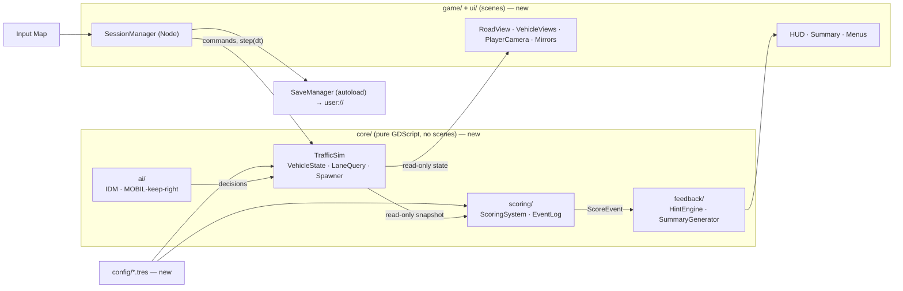
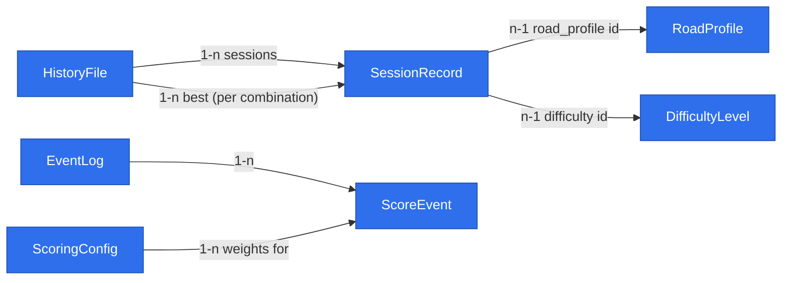

# Highway Driving Simulator — MVP

Source doc: [`wymagania-symulator-autostrady.md`](../../wymagania-symulator-autostrady.md) (requirements v0.1, Polish). This spec does not restate it; it records the decisions, architecture, and delivery plan on top of it. Section references like §8.2 point into the requirements doc. Where this spec and the requirements doc disagree, this spec wins: the Decisions table below resolves the doc's [OTWARTE] items, and the gendered example sentence in §11.3 is superseded by Q3.

## 📝 TLDR

Inexperienced Polish drivers never practise motorway habits — keeping right, signalling lane changes, keeping the legal gap (speed/2 m) — because driving courses barely touch motorways (§1). Nothing exists in this repo yet. We propose a browser game (Godot 4.7, GDScript, Web export on GitHub Pages) with 90-second scored sessions in a cockpit view, two modes (learn with live coaching, exam without), non-reactive traffic AI, rule-based verbal feedback, and local result history.

## 📝 Decisions (Open Questions resolved 2026-10-11)

All answered with the recommended default by the product owner.

| # | Question | Decision |
|---|---|---|
| Q1 | One spec or several | One umbrella spec; phases below are independently shippable. Split a phase into its own spec only if it outgrows one PR series. |
| Q2 | Hosting | GitHub Pages, deployed by GitHub Actions on push to `main`. |
| Q3 | Gendered Polish texts | Gender-neutral phrasing everywhere (impersonal / imperative / noun forms: "Odstęp był utrzymany", "Wróć na prawy pas"); no gender setting. |
| Q4 | Speeding | Penalised: rule **S1**, continuous penalty above `limit + tolerance` (tolerance [PARAM] 10 km/h), own category `speed`, toggle `speed_rule_enabled` in `scoring.tres`. |
| Q5 | Passing on the right | Not in MVP. |
| Q6 | Negative score | Total clamped at 0; category sub-scores may be negative internally (feedback uses them). |
| Q7 | K1 curve | Non-linear, `EXP = 2`. |
| Q8 | N3 with no leader in range | Reduced reward, factor [PARAM] 0.5. |
| Q9 | Exam pass | Passed = no collision/off-road AND `score_total ≥ exam_pass_score`, a per-level [PARAM] on `DifficultyLevel` (a fixed per-level threshold, not a ratio of a theoretical maximum — on dense levels full-rate N2/N3 for 90 s is unreachable). Initial values = 60% of a seeded ideal-driver bot's score per level, measured once in Phase 6 and written to the `.tres`; retuned in Phase 11. |
| Q10 | Blind-spot indicator | Learn mode only. |
| Q11 | Live score in exam HUD | Hidden; summary only. |
| Q12 | Lane change control | Discrete animated lane change, duration [PARAM] 1.75 s. |
| Q13 | Difficulty beyond density | Higher levels also widen AI speed spread and lower AI discipline, moderately (per-level [PARAM]s). |
| Q14 | Level unlocking | All levels available from the start; recommended level highlighted. |
| Q15 | Feedback form | On-screen text + simple icons; no voice. Simple sound effects (engine, indicator, passing cars, collision, off-road) added by the product owner in #72 — spec [`2026-10-13-sound-effects.md`](2026-10-13-sound-effects.md). |
| Q16 | Mobile / touch (supersedes requirements §2.2 / §3.1 for touch in a mobile browser) | The product owner added touch controls in a mobile browser (epic #85): on-screen buttons firing the keyboard's Input Map actions — spec [`2026-10-20-touch-controls.md`](2026-10-20-touch-controls.md). Native apps, a PWA, gestures, tilt and gamepads stay out of scope; the desktop keyboard stays the reference. |

## 📝 Problem Statement

See §1.1–1.3. Target users are low-experience drivers wanting to improve. This shapes every design choice: supportive tone, every message explains the rule, gentle difficulty, no pressure on first contact. Benchmark: LeftLane (leftlane.online) — cockpit view, short scored scenarios with coaching. We differ by covering only motorway/expressway, Polish law (art. 19 ust. 3 pkt 2 PoRD for the gap), learn/exam modes, and density-driven difficulty (§1.4).

Evidence status: the problem statement is the product owner's domain judgement; no user research exists yet. Phase 11 (playtests) is where it gets tested.

## 📝 Proposed Solution

A single Godot 4.7 project, Compatibility renderer, single-threaded Web export. A **pure-logic core** (simulation, AI, scoring, feedback) runs at a fixed 60 Hz step and knows nothing about scenes; the **presentation layer** renders the core's state relative to the player. All tunables are `.tres` resources. Results persist to `user://` (IndexedDB on web).

Alternatives considered:

- **Physics-engine driving (RigidBody/VehicleBody3D)** — rejected: non-deterministic across frame rates, hard to score precisely, and the requirements explicitly want an arcade model (§5.4) and discrete lane changes (Q12).
- **Continuous lateral steering** — rejected for MVP (Q12): makes "which lane am I in" and signal timing ambiguous for scoring.
- **Scripted scenarios instead of free traffic** (LeftLane's approach) — rejected as the primary mode because density-based difficulty is a stated differentiator; but see the *teachable-moment guarantee* below, which borrows the idea.

## 📝 Research — what the leaders do

- **Treiber & Kesting's IDM + MOBIL** (traffic-simulation.de, open-source JS) is the reference for browser traffic. Take: IDM for car-following (params `v0, T, s0, a, b`) and MOBIL with the **asymmetric "keep-right" variant** (bias term favouring the right lane, overtaking only on the left) — exactly the European rule we teach. Skip: on-ramps, ring roads, macroscopic stats.
- **SUMO** (LC2013 lane-change model) carries a `keepRight` motivation and sublane dynamics. Take: the idea that keep-right is a *motivation with a threshold*, not a hard rule — it is how we tune AI "discipline" (Q13). Skip: sublane model, junctions, routing.
- **LeftLane** guarantees each scenario contains the situation being taught. Random traffic at level 1 may contain no slower vehicle at all, so a session could teach nothing. Take: a **teachable-moment guarantee** — the spawner ensures at least `min_overtake_opportunities` [PARAM, default 2] slow vehicles (trucks) appear ahead of the player in the right lane per session. Cheap, data-driven, no scripting system.
- Typical IDM defaults from the literature, used as starting [PARAM]s: `T = 1.5 s`, `s0 = 2 m`, `a = 1.0 m/s²`, `b = 1.5 m/s²`; MOBIL `politeness = 0.2`, `threshold = 0.1 m/s²`, `b_safe = 4 m/s²`, `keep_right_bias = 0.3 m/s²`. Note: IDM's `T = 1.5 s` is *closer* than the legal gap at motorway speed (140 km/h → 58 m vs. 70 m legal). Model-driver AI therefore uses `T_eff = max(T, legal_gap / v)` scaled by discipline (§7.2).

## 📝 Architecture

Takeaway: data flows one way — input → simulation → (scoring, rendering) → feedback/UI. Scoring and rendering never write to the simulation; only `SessionManager` drives it.

Key mechanisms (only what is unique):

- **Coordinates.** A vehicle's state is `s` (metres along the road, float64 in GDScript), `lane` (int, 0 = rightmost), `lane_change: {from, to, progress 0..1}`, `speed_mps`, `signal: {dir, on_since_s}`, `length_m`, `width_m`, `kind`. Lateral position is derived: `lerp(lane_center(from), lane_center(to), ease(progress))`.
- **Floating origin by construction.** The renderer places every object at `z = -(s - player.s)`; the player is always at the origin, so float precision never degrades. Road segments (`segment_length_m` [PARAM] 50 m, pool of `segment_count` [PARAM] covering draw distance) are recycled from behind to front.
- **Fixed step.** `SessionManager._physics_process` calls `sim.step(1/60)`; physics ticks per frame capped (Godot `max_physics_steps_per_frame`) so a backgrounded tab does not fast-forward. The session auto-pauses on window focus loss.
- **Shared lane logic.** `LaneQuery.is_lane_free`, `gap_to_leader`, `min_gap`, `is_overtaking`, `signal_valid` (§8.4) are static, pure functions used by AI, scoring, and hints alike.
- **Player = vehicle.** The player is a `VehicleState` whose decisions come from `PlayerCommands` (accelerate/brake/none, lane-change request, signal toggle) instead of AI. A lane-change request during an active lane change is ignored. A request beyond the outermost lane starts a lane change that ends off-road (§9.2).
- **Collisions.** Axis-aligned boxes in `(s, lateral)` space, checked each step after integration. AI vehicles never collide by construction (IDM braking + MOBIL safety on the target lane); a test asserts zero AI–AI collisions over long seeded runs.
- **Spawner.** Maintains `density_per_km_per_lane` (level) within `[player.s − behind_m, player.s + ahead_m]`, spawning outside camera/mirror view and only where `is_lane_free` holds with a safety margin; skips a spawn rather than forcing one. Despawns beyond the window. Applies the teachable-moment guarantee. Uses an object pool for both state and views.
- **AI.** IDM acceleration; MOBIL-keep-right lane decisions, gated by `is_lane_free`. Before a lane change the AI signals for `ai_signal_lead_s` [PARAM] 1.5 s. Per-vehicle `discipline ∈ [0,1]` (drawn from the level's distribution) scales gap keeping and keep-right bias. AI ignores the player except as an IDM leader / MOBIL neighbour (§7.1).
- **Scoring.** `ScoringSystem.observe(snapshot, dt)` after each step; rules K1–K4, N1–N3, S1 as small rule objects with tunables from `scoring.tres`. Categories: `gap` (K1, N3), `lane` (K2, N1, N2), `signal` (K3), `speed` (S1), `collision` (K4). The summary shows the first four as category scores; `collision` is not a score bar but appears in the session status and the verbal summary ("1 kolizja"), and its points count toward the total. Continuous rules open/close **segments** (start, end, points, extreme value) in the `EventLog`; instantaneous rules emit single `ScoreEvent`s. N1 anti-farming: no reward for an unjustified left change, plus `lane_change_reward_cooldown_s` [PARAM].
- **Feedback.** `HintEngine` (learn mode) turns live rule states (e.g. K2 grace running) into preventive hints and events into after-the-fact messages, rate-limited per type and capped on screen (§11.2). `SummaryGenerator` picks one strength and one or two improvement areas by category totals, fills Polish templates (gender-neutral, Q3), and adds one "next time" tip (§11.3). Both pure and unit-tested on recorded event logs.
- **Session.** `SessionManager` state machine: `INTRO (3-2-1) → DRIVING ⇄ PAUSED → (RESPAWNING in learn) → ENDED`. Exam: collision/off-road → `ENDED(aborted_*)`. Learn: K4 penalty, fade, respawn on the right lane at the nearest free gap with `respawn_speed` [PARAM]; timer keeps running.
- **Mirrors.** Three `SubViewport`s sharing the main `World3D`, each with a rear-facing camera; render size and update interval come from the quality preset (low: 1/4 res, every 2nd frame; high: 1/2 res, every frame). Built and measured early (Phase 5) because it is the main web performance risk.
- **Localisation.** All player-facing strings in `i18n/strings.csv` (Godot CSV translations), Polish only for MVP.

## 📝 Data Model

All data is local; no personal data, no accounts (§14).

**Config resources** (`config/`, text `.tres`, one `Resource` script each):

- `RoadProfile` — `id`, `display_name_key`, `speed_limit_kmh`, `lane_count`, `lane_width_m` (3.75), `shoulder_width_m`. Instances: `motorway.tres` (140, 2), `expressway.tres` (120, 2).
- `DifficultyLevel` — `id` (1–4), `display_name_key`, `density_per_km_per_lane`, `truck_share`, `ai_speed_spread_kmh`, `ai_discipline_min/max`, `exam_pass_score`, `recommended: bool`.
- `ScoringConfig` (`scoring.tres`) — every K/N/S weight, exponent, grace period, cooldown, signal timing, `n3_empty_road_factor`, `speed_rule_enabled`, `speed_tolerance_kmh`, `score_floor` (0).
- `SimConfig` — physics and AI tunables (IDM/MOBIL params, lane change duration, spawn window, session length 90 s, start speed, respawn speed).
- `QualityPreset` — `low.tres` / `high.tres`: mirror resolution and interval, shadows, draw distance.

**Runtime only:** `VehicleState`, `ScoreEvent` (§8.6 shape, plus `segment_end_s` and `extreme` for continuous segments), `EventLog`, `InputLog` (per-step `PlayerCommands`; with the seed it makes a session replayable — §14 determinism needs inputs, not just the seed; kept in memory, exported only in debug builds).

**Persisted:** `SessionRecord`, built at session end by `SessionRecordBuilder` (core, pure) from the `EventLog` and session state — e.g. `time_left_lane_unjustified_s` = sum of K2 segment durations including grace, `time_gap_below_min_s` = sum of K1 segment durations, `min_gap_ratio` = min K1 extreme; stored in `user://history.json` — exactly the §13 JSON plus: `seed` (int, §14 determinism), `exam_passed` (bool|null), `score_by_category.speed`, `app_version`. File shape: `{ "schema_version": 1, "sessions": [SessionRecord…], "best": { "<mode>|<profile>|<level>": session_id } }`, capped at `history_limit` [PARAM] 200 (oldest dropped). Settings in `user://settings.cfg` (`ConfigFile`): quality, tutorial_seen, sessions_completed_learn.

No pre-existing entities: the repository has no code yet.

## 📝 API Contracts

No network API. Internal contracts that other parts depend on:

- **Signals** (`SessionManager` / `EventBus`): `session_started(config)`, `lane_change_started(vehicle_id, from, to)`, `lane_change_finished(vehicle_id, lane)`, `collision(vehicle_id, other_id)`, `offroad(vehicle_id)`, `score_event_emitted(event: ScoreEvent)`, `hint_shown(hint_id)`, `session_ended(record: SessionRecord)`.
- **Core API**: `TrafficSim.step(dt: float) -> void`, `TrafficSim.snapshot() -> SimSnapshot` (read-only view), `ScoringSystem.observe(snap: SimSnapshot, dt: float) -> Array[ScoreEvent]`, `SummaryGenerator.generate(log: EventLog, record: SessionRecord) -> Summary`.
- **Save format** (`schema_version: 1`) is the one durable contract: any change bumps the version and ships a migrator in `SaveManager`; unknown future versions are not overwritten (history shown read-only with a notice).
- **Input Map actions**: `accelerate`, `brake`, `lane_left`, `lane_right`, `signal_left`, `signal_right`, `pause` with the §6.3 bindings.

## 📝 UI/UX

Flow per §9.4: Start → (tutorial suggested on first run) → New session (mode · road profile · level, recommended level highlighted) → 3-2-1 → Drive → Summary → History / again. Settings: quality (low/high), mirrors on/off, key bindings preview.

States worth designing explicitly:

- **Summary**: completed / aborted (collision, off-road) / exam passed / exam failed; total + 4 categories (gap, lane, signal, speed) with icon + text; 2–4 sentence description; one tip; comparison with previous result and best for the same combination.
- **History**: empty state ("Brak zapisanych przejazdów…"), storage-unavailable state (private mode / IndexedDB blocked: sessions playable, saving disabled, explained), notice that data lives only in this browser (§13).
- **Learn HUD**: hint area (max [PARAM] 2 messages, per-type cooldown), blind-spot icons by side mirrors, live score.
- **Exam HUD**: no hints, no score, no blind-spot icons.
- Accessibility: messages never rely on colour alone (icon + text), readable fonts, min 1280×720, fullscreen toggle.

No prototype yet; the first playable build (Phase 3) serves as one.

## 📝 Edge Cases & Failure Scenarios

| Case | Behaviour |
|---|---|
| Lane change into an occupied lane | Change proceeds (§6.5); collision detected mid-change → K4 (learn) / session ends (exam). |
| Lane change requested while one is in progress | Ignored. |
| Lane change beyond outermost lane | Off-road at the end of the animation (§9.2). |
| Signal toggled during a lane change | Allowed; auto-cancel still fires when the change completes (§6.5). |
| Signal on in the wrong direction | K3 full penalty (WRONG). |
| Pause during lane change / countdown | Everything freezes, including timers and grace periods. |
| Browser tab hidden or window loses focus | Auto-pause; capped physics steps prevent fast-forward. |
| No free gap for learn-mode respawn | Despawn AI vehicles within the respawn window, then respawn. |
| Spawner cannot place a vehicle safely (dense level) | Skip this spawn; density converges over time. |
| AI–AI collision | Must not happen; guarded by a long-run seeded test. If it ever happens at runtime, both are despawned silently (never charged to the player). |
| `user://` / IndexedDB unavailable | Play works; save disabled; history shows the storage-unavailable state. |
| Corrupt or future-version history file | Corrupt: rename to `history.corrupt-<ts>.json`, start fresh, inform user. Future version: read-only, not overwritten. |
| Low FPS (< 30 sustained) | Suggest switching to low quality once per session (non-blocking toast). |
| WebGL 2 unavailable | Godot's export page shows its unsupported-browser message; no fallback renderer. |

## 📝 Risks & Impact Review

- **Web performance (highest).** Three mirror viewports + up to ~80 vehicles on integrated GPUs. Mitigation: mirrors in Phase 5 with an FPS measurement on level 4 as an exit criterion; quality presets; low-poly assets; vehicle view pooling.
- **Scoring balance is unproven.** Weights are guesses until playtested (Phase 11). Mitigation: all weights in `scoring.tres`; scoring unit tests assert *ordering* and acceptance criteria (§16), not absolute numbers.
- **Teaching correctness.** Messages state traffic law. Mitigation: each rule text cites its source in code comments; a one-line "educational tool, not legal advice" note on the start screen.
- **Save format is a durable contract** once real users have history; `schema_version` + migrations from day one. Worth adding `BACKWARD_COMPATIBILITY.md` once Phase 9 lands.
- **Godot version drift.** Pin 4.7.2 in `project.godot`, README, and CI; upgrades are their own PRs.
- **Web export size.** Godot 4 web template is ~40 MB uncompressed (~10 MB gzipped) — within the 50 MB budget only if assets stay low-poly; tracked in CI by printing the build size.

## 📋 Phasing

Each phase ends with `main` deployable and the validation gate green. Until Phase 10's menus exist, every feature is reachable on the deployed build through a **dev launcher** (Phase 3): URL query params `?mode=learn|exam&profile=motorway|expressway&level=1-4&seed=N` read via `JavaScriptBridge` on web (command-line user args on desktop), with defaults when absent. Phase 10 keeps the params as a debug shortcut.

| Phase | Ships | Depends on |
|---|---|---|
| 1. Skeleton & delivery pipeline | Empty game deployed to GitHub Pages by CI; tests run headless | — |
| 2. Simulation core | Headless `TrafficSim` with lanes, lane changes, collisions, input log, config resources | 1 |
| 3. Drivable road | Cockpit drive on an empty infinite road, basic HUD, 90 s session, dev launcher | 2 |
| 4. Traffic | AI traffic with IDM/MOBIL, spawner, 4 difficulty levels, AI signals and brake lights; placeholder: collision/off-road ends the session | 2, 3 |
| 5. Mirrors & quality | 3 mirrors, quality presets, measured FPS on level 4 | 3, 4 |
| 6. Scoring | All rules K1–K4, N1–N3, S1 + event log, session record builder (headless; can run in parallel with 3–5) | 2 |
| 7. Modes & session rules | Learn/exam, collision/off-road handling, respawn, pause; learn-only HUD (live score, blind-spot icons) | 4, 6 |
| 8. Feedback | Live hints (learn), summary screen with generated text | 6, 7 |
| 9. Results & history | Persistence, history screen, bests | 7 |
| 10. Menus, settings, tutorial | Full app flow per §9.4, tutorial (§12) | 7, 8, 9 |
| 11. Tuning & playtests | Tuned [PARAM]s, performance pass, playtest notes | all |

## 📋 Implementation Plan

### Phase 1 — Skeleton & delivery pipeline
1. Godot 4.7.2 project: `project.godot` (Compatibility renderer, single-threaded web export preset, 1280×720 base, stretch mode `canvas_items`/`expand`), Input Map actions per §6.3, directory layout per §15.1, `.gitattributes` (`* text=auto eol=lf`), Godot `.gitignore` entries (`.godot/`, `build/`). Main scene shows a "hello" label. *Test:* `godot --headless --path . --import` exits 0.
2. Add gdUnit4 (vendored in `addons/gdUnit4`, pinned to the latest release whose notes confirm Godot 4.7 support — v6.2.x at time of writing) and one trivial test in `tests/`. Confirm the gate commands in `.ai/agentic.config.json` run green locally; adjust them and `AGENTS.md`/`SDLC.md` if the gdUnit4 CLI differs. *Test:* both gate commands exit 0; a deliberately failing test makes the second exit non-zero.
3. GitHub Actions workflow: on PR — import + tests; on push to `main` — also export Web (pinned Godot + export templates) and deploy to GitHub Pages; print build size. README with Godot version and how to run locally. *Test:* workflow green on the PR; Pages URL serves the hello scene.

### Phase 2 — Simulation core
1. `RoadProfile`, `SimConfig` resources + `motorway.tres`/`expressway.tres`; `VehicleState`; `TrafficSim` with longitudinal integration (arcade accel/brake, min 0, max speed). *Tests:* speed clamps, integration over fixed steps is deterministic.
2. Lane changes: request → animated `progress` over `lane_change_duration`, ignore during active change, off-road beyond edges; signals with `on_since_s` and auto-cancel. *Tests:* lateral position at progress points, ignore-while-changing, off-road detection, auto-cancel.
3. `LaneQuery` (`is_lane_free`, `gap_to_leader`, `min_gap`, `is_overtaking`, `signal_valid`). *Tests:* table-driven cases incl. §16 (140 km/h → min gap 70 m), each `signal_valid` outcome.
4. Collision detection in `(s, lateral)` space; seeded RNG owned by the sim; `InputLog` recording `PlayerCommands` per step. *Tests:* overlap/no-overlap boxes incl. mid-lane-change; same seed + same input log → identical final state.

### Phase 3 — Drivable road
1. `RoadView`: recycled segments (lanes, dashed/solid markings, shoulder, barrier, opposite carriageway, simple terrain) placed relative to the player. *Test:* scene test — after driving 10 km of sim time no segment gap; manual check of no popping.
2. Player wiring: Input Map → `PlayerCommands` → sim; cockpit camera with dashboard/bonnet mesh; lateral motion follows lane-change progress. *Test:* input-mapping unit test; manual drive.
3. Basic HUD (speed, limit, signal arrows, session timer) + `SessionManager` with INTRO countdown → DRIVING → ENDED after 90 s, start on right lane at start speed. *Test:* session timer ends at 90 s of sim time (headless test with stepped sim).
4. Dev launcher: parse `mode/profile/level/seed` query params (web) or user args (desktop) into the session config, with validation and defaults. *Test:* unit test of the parser (valid, missing, invalid values); manual check on the Pages build with `?profile=expressway` showing a 120 limit.

### Phase 4 — Traffic
1. IDM car-following with legal-gap-aware `T_eff` and discipline. *Tests:* free-road acceleration to `v0`, approach-and-follow converges to the expected gap, no overlap with a stopped leader.
2. MOBIL-keep-right lane decisions using `LaneQuery`, AI signalling lead time, overtake-then-return behaviour. *Tests:* scripted scenes — fast car behind slow truck overtakes and returns right; no lane change into an unsafe gap.
3. `DifficultyLevel` resources (4 levels), spawner with safe placement, despawn window, pooling, teachable-moment guarantee. *Tests:* density within ±20% of target after 30 s warm-up per level; zero AI–AI collisions over a 10 min simulated run per level × profile (whole suite budget ≤ 60 s of CI wall time; longer soak runs are a manual/nightly task, not part of the gate); never spawns within the safety margin of the player; ≥ `min_overtake_opportunities` slow vehicles per session.
4. Vehicle views: 3 low-poly kinds × colours, brake lights, blinking indicators, pooled. Placeholder until Phase 7: player collision or off-road ends the session with a plain "session ended" screen. *Tests:* view count equals live vehicle count (scene test); headless test that a forced collision ends the session.

### Phase 5 — Mirrors & quality
1. Rear-view + two side mirrors via `SubViewport`s, `QualityPreset` low/high, settings toggle for mirrors. *Test:* manual; mirrors show approaching vehicles in correct lanes.
2. Performance check with a reproducible method: an in-game FPS probe (dev launcher flag `&perf=1`) samples `Performance.TIME_FPS` for 60 s of driving and prints average and 5th-percentile FPS. Run on the **reference machine** — the product owner's integrated-GPU laptop, model, GPU, and browser recorded in the README — with Chrome, level 4, motorway, `seed=1`, both presets; results in the PR. *Exit criterion:* average ≥ 30 FPS and 5th percentile ≥ 25 FPS on the low preset (§16).

### Phase 6 — Scoring
1. `ScoringConfig`, `ScoreEvent`, `EventLog` with segment aggregation. *Tests:* continuous events open/close segments with correct sum and extreme.
2. Rules K1 (non-linear, not while overtaking), K2 (grace then continuous, not while overtaking), K3 (NONE/LATE/WRONG). *Tests:* every §16 scoring criterion as a test (50 m vs 75 m at 140 km/h; 20 m > 50 m penalty; no K1 while overtaking; K2 only after grace).
3. Rules N1 (justified + signalled + safe + cooldown), N2, N3 (with empty-road factor), S1 speeding, K4 hook (category `collision`), total clamp at 0. *Tests:* repeated pointless lane changes do not increase score; right-lane driving with correct gap increases score steadily; S1 off when disabled.
4. `SessionRecordBuilder` (EventLog + session state → §13 record incl. `stats`), and an ideal-driver bot used once to set initial per-level `exam_pass_score` values. *Tests:* recorded logs → expected `stats` and category totals; the bot run is deterministic per seed.

### Phase 7 — Modes & session rules
1. Mode selection plumbing; exam: collision/off-road → `ENDED(aborted_*)` with cause. *Tests:* headless session tests for both abort causes.
2. Learn: K4 + fade + respawn at safe gap (despawning blockers if needed), timer continues; pause (Esc/P) and auto-pause on focus loss (`NOTIFICATION_APPLICATION_FOCUS_OUT`). *Tests:* respawn position is free; timer unaffected by respawn; paused session does not advance; sending the focus-out notification to `SessionManager` pauses it.
3. Learn-only HUD: live score and blind-spot icons (driven by `LaneQuery`), hidden in exam. *Tests:* HUD visibility per mode (scene test); blind-spot query unit tests.

### Phase 8 — Feedback
1. `HintEngine` with preventive hints (K2 grace, gap closing) and event messages, explanations with live numbers ("Przy 120 km/h minimum to 60 m, masz 35 m"), rate limiting. *Tests:* rate limit per type, max on screen, message chosen per event.
2. `SummaryGenerator` + Polish gender-neutral templates in `i18n/strings.csv`; summary screen per UI/UX states, incl. exam pass/fail. *Tests:* recorded event logs → expected strength/improvement selection and sentence count 2–4; no gendered verb forms (lint test over strings).

### Phase 9 — Results & history
1. `SaveManager` autoload: write/read `history.json`, schema v1, cap, bests, corrupt/future-version handling, storage-unavailable detection. *Tests:* round-trip, cap, best update, corrupt file recovery, future-version read-only.
2. History screen (list, bests per combination, simple trend chart), comparison on summary. *Test:* survives page reload on the web build (manual, recorded in PR).

### Phase 10 — Menus, settings, tutorial
1. Start screen, new-session setup (mode/profile/level, recommended highlighted, exam suggested after 3 learn sessions), settings (quality, mirrors, key bindings preview), "educational tool" note. *Tests:* unit test of the exam-suggestion rule (0–2 vs ≥ 3 completed learn sessions); settings round-trip through `settings.cfg`; manual flow.
2. Tutorial: empty road, no scoring, step-by-step prompts (§12), skippable, re-runnable from the menu. *Test:* tutorial step progression unit test on prompts state machine.

### Phase 11 — Tuning & playtests
1. Tune [PARAM]s from internal play; performance pass on the web build; build-size check against 50 MB.
2. Playtests with 3–5 target users (§1.3); record findings in `.ai/analysis/`; file follow-ups.

*Exit criteria:* every §16 acceptance criterion checked off with evidence (test name or recorded manual check); build ≤ 50 MB; Phase 5 FPS criterion re-measured on the final build; playtest notes filed.
