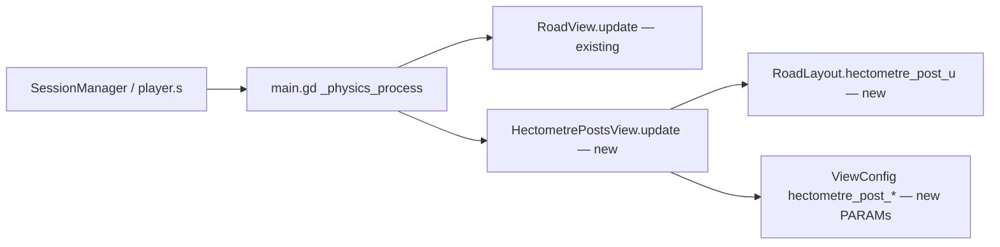

# Hectometre posts along the roadside

Refs #68 · Parent: [MVP spec](2026-10-11-highway-driving-simulator-mvp.md) (Phase 3 drivable road, Phase 5 mirrors)

## 📝 TLDR
Learners practising the gap rule (half the speed in km/h, in metres — K1 / N3) have nothing on the road to measure distance against: lane dashes are uniform and the barrier is continuous. Proposed: a plain white post with a black band beside the right shoulder every 100 m of road, fixed in road coordinates, so "the car ahead is about one post away" reads as ≈ 100 m. Presentation only — no change to the simulation, scoring, or save format.

## 📝 Problem Statement
The legal following distance is a number of metres (requirements §8, K1 / N3), but the player cannot judge metres from the cockpit. On a real Polish motorway the hectometre posts (*słupki hektometryczne*, every 100 m) are the usual reference. Requested by the product owner (issue #68); every player benefits, learners most.

## 📝 Proposed Solution
A new pooled view, `HectometrePostsView`, placed beside `RoadView` in `game/main.tscn` and driven by the same `update(player_s)` call. Post *k* stands at `s = k × hectometre_post_spacing_m` and is drawn at `z = -(s - player_s)` — the floating-origin rule `RoadView` already uses. Posts exist exactly where road exists: the view derives its window from the same segment window `RoadView` keeps (`floori(player_s / segment_length_m) - segments_behind`, `segment_count` segments), so a post can only appear on a stretch that is itself appearing beyond `draw_distance_m()` — no popping, and the mirrors (which share `World3D` and see `mirror_range_m() = covered_behind_m()`) see the posts behind for free.

Alternatives rejected:
- **Bake posts into the shared segment mesh** — the segment is 48 m and the spacing is 100 m, so segments are not identical any more; it would break the single shared mesh and its one-draw-call-per-material budget.
- **Extend `RoadView`** — mixes two pools with different periods in one recycler; a sibling view keeps `RoadView` untouched and each class testable on its own.
- **`MultiMeshInstance3D`** — fewer draw calls, but at ≤ 8 posts the gain is negligible and it departs from the `RoadView` pooling primitive. Revisit only if the perf check says so.

## 📝 Architecture

`main.gd` feeds both views the same `player.s`; the new view only reads it.

- **`config/view_config.gd` + `view_config.tres`** — new [PARAM]s (no literals in code):
  - `hectometre_post_spacing_m` = 100.0
  - `hectometre_post_height_m` = 1.0 (above the 0.75 m barrier, so it reads against the sky line)
  - `hectometre_post_width_m` = 0.12 (square cross-section)
  - `hectometre_post_offset_m` = 0.25 — from the outer edge of the shoulder outwards, i.e. the middle of the `barrier_offset_m` (0.5 m) gap
  - `hectometre_post_color` = white, `hectometre_post_band_color` = black, `hectometre_post_band_height_m` = 0.2 (band just below the top)
  - `hectometre_post_count()` — pool size: `ceili(segment_count × segment_length_m / hectometre_post_spacing_m)`, the most multiples of the spacing the road window can hold. Taken from the session's `for_quality` copy, so it follows the preset's draw distance.
- **`game/world/road_layout.gd`** — `hectometre_post_u() -> float`: `-(road.shoulder_width_m + view.hectometre_post_offset_m)`. Profile-dependent through `shoulder_width_m` (motorway 3.0 m → −3.25; expressway 2.5 m → −2.75).
- **`game/world/hectometre_posts_view.gd`** (`HectometrePostsView`, `Node3D`):
  - `setup(road_profile, view_config)` builds one shared `ArrayMesh` (two surfaces: body, band; materials from the config colours) and a pool of `hectometre_post_count()` `MeshInstance3D` children.
  - `update(player_s)` computes the road window `[first × L, (first + segment_count) × L)`, assigns each post index *k* with `k × spacing` in it to a pooled node (recycling only the slots whose index left the window, as `RoadView._recycle` does), places it at `(x_of(hectometre_post_u()), 0, -(k × spacing - player_s))`, and hides any unused slot.
  - `posts() -> Array[MeshInstance3D]` for inspection, like `RoadView.segments()`.
- **`game/main.tscn` / `game/main.gd`** — a `HectometrePosts` node next to `RoadView`; `setup` with the same profile and quality-adjusted `ViewConfig`; `update(player.s)` right after `_road_view.update`.

## 📝 UI/UX
A 3D roadside object, not a screen: visible from the cockpit camera and in all three mirrors, both modes (learn and exam — it is part of the road, not a hint). No text, no HUD change, no new strings. Posts on the right roadside only. No mockups: this repository has no test-environment descriptor for browser capture, and the change is a single static prop.

## 📝 Edge Cases & Failure Scenarios
- **Session start at `s = 0`** — the window includes negative indices behind the player; posts at `s = −100 …` are drawn like any other (the road also exists there).
- **Learn-mode respawn** moves the player outside `TrafficSim.step`; the next `update(player_s)` recomputes the window and recycles, exactly as `RoadView` does.
- **Low quality preset** — fewer segments → a shorter window → fewer posts; the pool is sized from the same copy, so it never runs short.
- **Long sessions** — positions are `k × spacing - player_s` in float64 GDScript math before the float32 transform; at 90 s × 140 km/h (≈ 3.5 km) precision is not a concern.
- **Straight road assumed** — the road is straight (requirements §4.3), so a post's lateral `x` is constant; a curved road would need the layout to supply `x(s)`.
- **Misconfiguration** — `hectometre_post_offset_m ± width/2` outside the barrier gap would put the post in the barrier or on the shoulder; a unit test asserts the shipped config fits between the shoulder edge and the barrier for both profiles.

## 📝 Risks & Impact Review
Low blast radius: additive view node, additive `ViewConfig` fields, no change to `core/`, scoring, the save format, or any signal. Rollback is removing the node. The one budget at stake is FPS (60 target / 30 min on an integrated GPU): ≤ 8 extra meshes × 2 surfaces, each also rendered by up to three mirror viewports. The issue's acceptance criterion asks for a `perf=1` level-4 comparison against `main` on the reference machine — a manual measurement the implementation PR must record or flag as pending (it cannot be run headless in CI).

## 📋 Phasing
One phase — independently shippable, a single PR.

## 📋 Implementation Plan

### Phase 1 — Hectometre posts
1. **Config and layout.** Add the `hectometre_post_*` exports and `hectometre_post_count()` to `ViewConfig` and their values to `view_config.tres`; add `RoadLayout.hectometre_post_u()`. Tests (`tests/game/world/road_layout_test.gd`): the lateral offset per profile (motorway, expressway), and that the post's footprint lies strictly between the shoulder edge (`-shoulder_width_m`) and the barrier's inner face for both profiles.
2. **`HectometrePostsView`.** New `game/world/hectometre_posts_view.gd` with the shared two-surface mesh, the pool and `update(player_s)`. Tests in `tests/game/world/hectometre_posts_view_test.gd`: (a) for a given `player_s`, every visible post sits at a multiple of the spacing and at `z = -(s - player_s)`, at `x = x_of(hectometre_post_u())`; (b) every multiple of the spacing within `[player_s - covered_behind_m(), player_s + draw_distance_m()]` has a visible post; (c) driving 10 km keeps (b) true at every step with the same pooled nodes — child count unchanged, no create/free; (d) no visible post lies outside the road window; (e) the pool never runs short at window edges — `player_s` exactly on a segment boundary and a window whose both ends fall on multiples of the spacing.
3. **Wire into the game.** Add the node to `game/main.tscn`, call `setup` and `update` from `main.gd` next to `RoadView`. Test: the main scene builds a `HectometrePostsView` with a non-empty pool (extend the existing main-scene test if present, else a minimal one). Update the AGENTS.md rendering row to name the new view. Record the `perf=1` level-4 measurement in the PR, or flag it as pending for the reference machine.

## Resolved assumptions (autonomous defaults)

| # | Question | Default applied | Rationale |
|---|---|---|---|
| Q1 | Should the post show a hectometre number, like the real ones? | **No** — plain white post with a black band, no number. | Non-blocking in the issue, which names this default; a number needs a label or texture (new asset, i18n-free text rendering, extra draw calls) and is a clean follow-up. |
| Q2 | Posts also on the median side? | **No** — right roadside only. | Non-blocking in the issue, which names this default; smallest scope, half the draw calls, and the right side is where the player looks for the shoulder. |
| Q3 | Separate view or extend `RoadView`? | **Separate `HectometrePostsView`** sharing `RoadView`'s window formula. | Keeps the existing, tested recycler untouched; different periods (48 m vs 100 m) would complicate one pool. |
