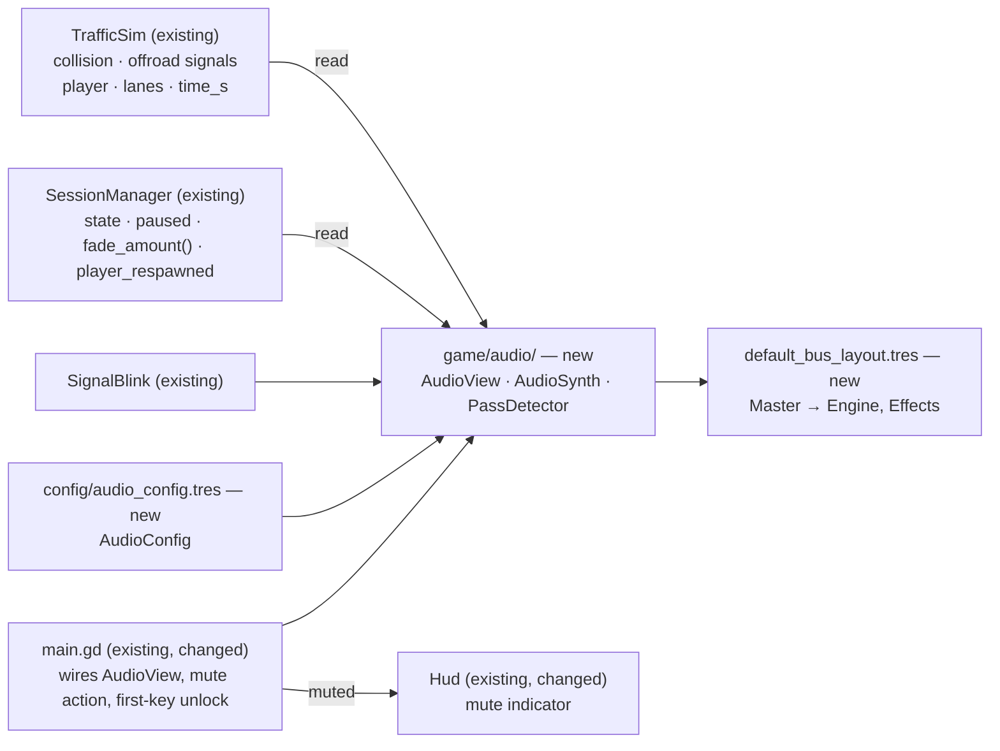

# Sound effects

Source doc: issue [#72](https://github.com/kreciol/simulator/issues/72). Builds on the MVP spec [`2026-10-11-highway-driving-simulator-mvp.md`](2026-10-11-highway-driving-simulator-mvp.md); section references like §2.2 point into [`wymagania-symulator-autostrady.md`](../../wymagania-symulator-autostrady.md).

## 📝 TLDR

Every player drives in silence today: speed is only a number on the dashboard, a forgotten indicator is only a blinking arrow, and a car passing close by is only seen. We propose simple, unobtrusive sound effects — an engine note that follows the speed, the indicator's tick-tock, a whoosh for close passes, and one-shots for a crash and for leaving the road — plus a mute key. The sounds are synthesised at start-up (no asset files, no licences), read the simulation only, and change nothing in `core/`, so scoring and replays stay deterministic.

## 📝 Decisions in play

- **Supersedes MVP decision Q15** ("On-screen text + simple icons; no audio") for **simple sound effects only**, as requested by the product owner (the owner of Q15) in #72. Voice messages and spoken feedback stay out (§2.2). The implementation updates the Q15 row of the MVP spec's *Decisions* table.

## 📝 Problem Statement

A driver hears as much as sees: the engine says how fast the car goes, the ticking reminds that the indicator is still on, and a car alongside is heard before it is in view. The game is silent (Q15), so the drive feels less real, and a forgotten indicator — which K3/N1 scoring cares about — is easy to miss. Requested by the product owner for every player.

## 📝 Proposed Solution

A new presentation node, `AudioView` (`game/audio/`), wired in `game/main.tscn` like `TrafficView` and `MirrorsView`: each frame it reads `SessionManager` and `TrafficSim` and drives a handful of `AudioStreamPlayer`s.

| Sound | Trigger (read-only) | Shape |
|---|---|---|
| Engine | always while driving | one looping stream; `pitch_scale` and volume mapped from `player.speed_mps` |
| Indicator | edges of `SignalBlink.is_lit(player, sim.time_s, view_config.signal_blink_hz)` | "tick" on lit, "tock" on unlit — the same phase as the dashboard lamp and HUD arrow |
| Pass | an AI vehicle on lane `player.lane ± 1` whose centre crosses the player's `s` | one whoosh per crossing; volume from lateral distance and relative speed |
| Collision | `TrafficSim.collision` involving the player | one-shot impact |
| Off-road | `TrafficSim.offroad` for the player | one-shot rumble |

**Synthesis, not samples.** At start-up `AudioSynth` builds each sound as an in-memory `AudioStreamWAV` (16-bit mono PCM): the engine as a seamless loop of a few harmonics, tick/tock as short decaying clicks, whoosh/impact/rumble as enveloped, low-passed noise from a **local, fixed-seed** `RandomNumberGenerator` (never `TrafficSim.rng`). `AudioStreamWAV` is a regular sample stream, so it plays in the single-threaded web export's default *sample* playback and supports `pitch_scale` there.

Alternatives considered:
- **CC0 sample files** — more realistic, but every file needs a source/licence entry, adds package size, and still needs a looped, pitch-shifted engine. Kept as a later swap: `AudioSynth` is the only producer of streams, so replacing one with an imported file touches one function.
- **`AudioStreamGenerator` (real-time synthesis)** — rejected: it needs a script pushing frames every frame and is not supported by the web *sample* playback path; on the no-threads export it risks crackle and an FPS cost.
- **`AudioStreamPlayer3D` on the pooled `VehicleView`s** for passes — rejected: a positional player per pooled view costs more on web than one pooled 2D one-shot, and the cockpit camera would still need the crossing logic to avoid a continuous drone.

Research (what driving games do): arcade and sim titles (e.g. the open-source *Speed Dreams*, *TORCS*, *SuperTuxKart*) pitch-shift one or a few looped engine samples by RPM and cross-fade layers; indicator clicks are tied to the lamp's blink, not a separate timer; pass-bys are short Doppler-ish noise sweeps triggered by proximity. We take the single-loop pitch shift (no gears, no RPM model — the car has none), the lamp-synced click, and a triggered whoosh; we skip Doppler, layering and 3D positioning as complexity a 90-second learning game does not need.

## 📝 Architecture

Takeaway: audio is one more read-only view; nothing in `core/` changes and nothing flows back into the simulation.

- **`AudioView` (Node).** `setup(sim, session, view_config, audio_config, top_speed_kmh)` builds the streams and players (engine on the `Engine` bus; tick, pass pool, impact, rumble on `Effects`), connects `sim.collision` / `sim.offroad` (filtered on `session.player.id`) and `session.player_respawned`, and `update(delta)` runs each frame from `main.gd`'s `_update_views`.
- **Silence rules.** Engine, indicator and passes sound only in `DRIVING` and `RESPAWNING`, never in `INTRO`, while `paused`, or in `ENDED`. On pause every player is `stream_paused` (one-shots resume with the session); on `ENDED` the engine stops. During a respawn the engine's volume follows `1 − session.fade_amount()`. The indicator needs no extra rule: `sim.time_s` stands still whenever the sim does, so no blink edge occurs.
- **Engine mapping.** `t = clamp(speed_kmh / top_speed_kmh, 0, 1)`, `pitch_scale = lerp(engine_pitch_min, engine_pitch_max, t)`, `volume_db = lerp(engine_volume_min_db, engine_volume_max_db, t)`. `top_speed_kmh` = road profile `speed_limit_kmh` + `session.scoring_config.speed_tolerance_kmh` (the S1 threshold, as #72 asks), passed in by `main.gd`; above it (up to `SimConfig.max_speed_kmh`) the pitch stays at its top. Speed changes continuously, so the pitch has no steps.
- **`PassDetector` (RefCounted, pure).** Keeps, per AI vehicle id on lanes `player.lane ± 1` (`LaneQuery.occupies_lane`, scanning `sim.lanes.on_lane(lane)` within `player.s ± pass_scan_window_m`), the sign of `vehicle.s − player.s` from the previous frame. A sign flip with lateral centre distance ≤ `pass_sound_range_m` and relative speed ≥ `pass_min_relative_speed_kmh` yields one pass with `loudness = proximity × speed_factor` in [0, 1]. Ids not seen this frame are dropped (despawn, lane change away); `player_respawned` clears all state, so a teleport is never a pass. It runs once per rendered frame (zero or several sim steps); the scan window is wider than any relative distance covered in one frame, so no crossing is skipped. A frozen frame cannot cross (positions do not move).
- **One-shots per incident.** The sim emits `collision` once per new contact pair (its contact bookkeeping), and `offroad` once when a lane change ends off the road (`TrafficSim._advance_lane_change`), so one signal = one sound. Both fire inside `sim.step`, before `SessionManager` switches to `RESPAWNING`/`ENDED`, so the sound starts before the respawn fade and plays on through the exam's end screen.
- **Mute and autoplay.** A new Input Map action `mute` (`M`) is handled in `main.gd` next to `pause` (input.md: not a driving command) and toggles `AudioView.user_muted` (seeded from `muted_by_default`). The `Master` bus is muted while `locked or user_muted`: `locked` holds until the first key, mouse button or touch event `main.gd` forwards (`AudioView.unlock()`), so no sound plays before a user gesture on any platform and unlock and `M` never overwrite each other. Godot's web build creates its audio context at start-up and resumes it on the first gesture itself; the Master mute only keeps sound from bursting in mid-drive, and nothing in our code touches the audio context. `main.gd` passes `AudioView.user_muted` to the HUD each frame (`Hud.set_muted`), which shows a persistent icon + text while muted. Mute is session-only; volume settings belong to E11-S02 (#44).
- **Streams are immutable.** Every stream is built once in `setup` and never modified: the web sample path uploads a stream's data to the browser on its first play and keeps that copy. No bus effects are used (the sample path does not apply them); only bus volume and mute.

## 📝 Data Model

New `AudioConfig` resource (`config/audio_config.gd` + `config/audio_config.tres`), every value a [PARAM], nothing defaulted in code:

| Field | Initial value | Meaning |
|---|---|---|
| `master_volume_db` | −6 | `Master` bus volume until E11-S02, applied in `setup` (the bus layout keeps 0 dB, so this is the only source) |
| `muted_by_default` | false | sound on (after the first key press) |
| `engine_pitch_min` / `engine_pitch_max` | 0.6 / 1.8 | pitch at 0 km/h / at `top_speed_kmh` |
| `engine_volume_min_db` / `engine_volume_max_db` | −18 / −8 | engine loudness range |
| `engine_base_hz` | 55 | synthesised engine fundamental |
| `indicator_volume_db` | −10 | tick/tock |
| `pass_sound_range_m` | 4.5 | max lateral centre distance that counts as a close pass |
| `pass_min_relative_speed_kmh` | 10 | slower crossings make no whoosh |
| `pass_full_speed_kmh` | 60 | relative speed at which the whoosh is at full loudness |
| `pass_volume_max_db` / `pass_volume_min_db` | −6 / −24 | loudness range of a whoosh |
| `pass_scan_window_m` | 30 | longitudinal half-window around the player scanned for crossings |
| `pass_voices` | 3 | pooled whoosh players |
| `collision_volume_db` / `offroad_volume_db` | −3 / −6 | one-shots |
| `synth_mix_rate` | 22050 | sample rate of the synthesised streams |

No persisted data changes; mute is not saved.

## 📝 UI/UX

- **Mute indicator** (HUD, both modes): while muted, a small speaker-with-cross icon and the text `Dźwięk wyłączony (M)` in a corner that holds no other widget; hidden when sound is on. Icon + text, never colour alone (hud.md). Strings in `i18n/strings.csv`, gender-neutral.
- No other screen changes; no settings screen (E11-S02).

## 📝 Edge Cases & Failure Scenarios

- **No gesture yet** — the session can start and drive silently; sound starts with the first key, click or touch (browser autoplay policy). Driving needs keys, so in practice sound starts at the first accelerate.
- **Audio unavailable** (no output device, a browser that refuses the audio context) — Godot falls back to its dummy driver; players play into nothing, no error, the game is unaffected.
- **Headless tests** — the dummy audio driver makes `playing` and one-shot completion timing-dependent, so the trigger logic (engine mapping, blink edges, pass detection, voice choice, silence rules) lives in pure functions and per-sound trigger counters that tests assert; players are checked only for `stream`, `stream_paused`, `pitch_scale` and `volume_db`.
- **Many passes at once** (dense level 4) — the whoosh pool (`pass_voices`) steals the oldest voice; never more than `pass_voices` concurrent.
- **Lane change mid-pass** — `occupies_lane` counts a vehicle on both lanes during its change; a vehicle leaving the neighbour lanes is dropped, so it cannot fire a stale crossing later.
- **Respawn teleport / `place_vehicle`** — `player_respawned` resets the pass detector.
- **Window focus lost** — `SessionManager` pauses, so audio pauses with it; returning focus does not resume (session-flow rule).
- **Web `pitch_scale` in sample playback** — if a browser ignores it (risk below), the fallback is the project setting `audio/general/default_playback_type.web = Stream`.

## 📝 Risks & Impact Review

- **Product direction:** supersedes Q15 for simple effects only — owner-approved in #72; recorded in the MVP spec's Decisions table by the implementation.
- **Web audio (medium).** Single-threaded export + sample playback is the least-tested Godot audio path; the first phase includes a manual web smoke check (engine pitch audible, no console autoplay errors) before the remaining sounds land.
- **Performance (low).** A few 2D players and a pass scan over two lanes near the player per frame; synthesis runs once at start-up (≈1 s of 22 kHz mono per loop, a few hundred KB of RAM). Verified with `perf=1` on level 4 against `main` (README method).
- **Package size:** unchanged (no asset files).
- **Determinism:** no `core/` change, no use of `TrafficSim.rng`; the existing `core/` scan test and replay tests stay green.
- **Reversibility:** removing the `AudioView` node from `main.tscn` (and the `mute` action) restores the silent game; no data, schema or save-format impact.

## 📋 Phasing

- **Phase 1 — Audio foundation and engine:** buses, `AudioConfig`, `AudioSynth`, `AudioView` with the engine sound and silence rules, first-key unlock, mute action + HUD indicator. Ships a game with an engine and a mute key.
- **Phase 2 — Indicator and incidents:** tick-tock synced to `SignalBlink`; collision and off-road one-shots.
- **Phase 3 — Passing vehicles:** `PassDetector` and the pooled whoosh; perf check on level 4; Q15 row and agent docs updated.

## 📋 Implementation Plan

### Phase 1 — Audio foundation and engine
1. `default_bus_layout.tres` (Master → `Engine`, `Effects`) registered in `project.godot`; `AudioConfig` script + `config/audio_config.tres`; config test (values present, ranges sane, min < max).
2. `game/audio/audio_synth.gd`: static builders returning `AudioStreamWAV` (engine loop with `loop_mode = LOOP_FORWARD`, tick, tock, whoosh, impact, rumble) from a fixed local seed; tests: format/mix rate, non-empty data, loop points, same bytes on two builds.
3. `game/audio/audio_view.gd` with the engine: speed → pitch/volume mapping (a static, tested function), silence in `INTRO` / paused / `ENDED`, respawn fade; wired in `game/main.tscn` / `main.gd`; tests in `tests/game/audio/`.
4. `mute` action (`M`) in the Input Map, handled in `main.gd`; Master bus muted until the first key press (`AudioView.unlock()`); `Hud.set_muted` icon + text and the strings; tests: locked before the first key, mute toggles the bus and the HUD, `project_settings_test` lists the action. Manual web smoke check of the engine: pitch audible and changing, no sound before the first gesture (Edge Cases: web `pitch_scale`).

### Phase 2 — Indicator and incidents
5. Indicator: tick on the lit edge, tock on the unlit edge of `SignalBlink.is_lit`; tests: ticks only while `signal_dir != NONE`, edges coincide with the lamp's phase, none while paused / in `INTRO`.
6. Collision and off-road one-shots from `TrafficSim.collision` / `offroad` filtered on the player; tests: one sound per incident in learn (before the fade) and exam, none for AI–AI collisions.

### Phase 3 — Passing vehicles
7. `game/audio/pass_detector.gd` (pure) + pooled whoosh in `AudioView`; tests: one pass per crossing (overtaking and being overtaken), none beyond `pass_sound_range_m` or two lanes away or below the minimum relative speed, loudness grows with proximity and relative speed, no pass after a respawn teleport, voice stealing at `pass_voices`.
8. `perf=1` on level 4 against `main` (README method), result in the PR; MVP spec Q15 row updated; `docs/agents/audio.md` (read-only view, synthesised streams, buses, silence rules) with its `AGENTS.md` routing line and `CLAUDE.md` import.

## Resolved assumptions (autonomous defaults)

| # | Question | Default applied | Rationale |
|---|---|---|---|
| Q1 | Sound assets (CC0 samples) or procedural synthesis? | Synthesis at start-up into `AudioStreamWAV` | No licences or package growth; plays in the web *sample* path (unlike `AudioStreamGenerator`); `AudioSynth` keeps a later swap to samples to one function. |
| Q2 | Sound on by default? | On, after the player's first key press | The issue's default; satisfies browser autoplay policy. |
| Q3 | Before or after the MVP acceptance pass (E12, #47)? | Before, so playtests (#48) include it | The issue's default; a planning call that does not change this design. |
| Q4 | One spec or one per sound (independently deployable)? | One spec, three phases | The sounds share one view, buses, config and mute; each phase ships on its own. |
| Q5 | Should mute persist between sessions? | No — session-only until settings (E11-S02, #44) | Smallest scope; no save-format change. |
| Q6 | Where does the engine's top speed come from? | Profile `speed_limit_kmh` + `ScoringConfig.speed_tolerance_kmh`; flat pitch above it | The issue's acceptance criterion names "limit + tolerance"; reusing the S1 threshold avoids a duplicate [PARAM]. Alternative: `sim.max_speed_mps()` (180 km/h), so the pitch keeps rising to the sim's cap. |
