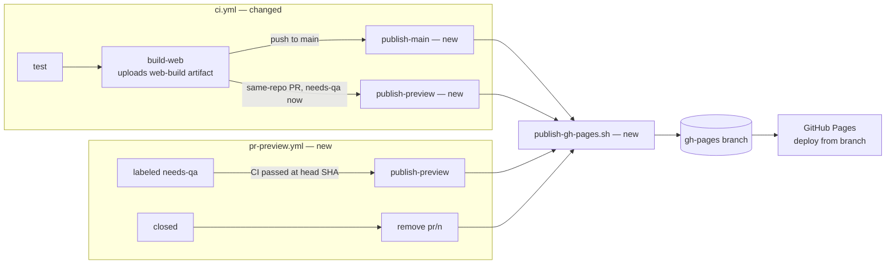

# Web preview of every `needs-qa` PR on GitHub Pages

Source doc: issue [#91](https://github.com/kreciol/simulator/issues/91). Touches only CI (`.github/`) and the process docs (`SDLC.md`, `docs/agents/project-setup.md`, `README.md`); no game code changes.

## 📝 TLDR

Today the QA reviewer has to export every `needs-qa` PR locally (worktree, `godot --export-release "Web"`, a local HTTP server) — slow, tied to one machine and impossible on a phone. We propose that CI publishes the web build it already makes to `https://kreciol.github.io/simulator/pr/<n>/<sha7>/` on the existing Pages site whenever a same-repo PR carries `needs-qa`, and links it from one bot comment on the PR. To make room for previews, Pages moves from the artifact deploy (`actions/deploy-pages`, which replaces the whole site) to **deploy from the `gh-pages` branch**, where `main` owns the root and previews live under `pr/`.

## 📝 Resolved assumptions (autonomous defaults)

| # | Question | Applied default | Why |
|---|---|---|---|
| Q1 | Keep a preview after `needs-qa` is removed (e.g. replaced by `qa-approved`) until the PR closes? | **Yes** — removed only on close. | The issue's own default; the link stays valid for the `QA head:` it was tested at. |
| Q2 | Third-party deploy actions (`JamesIves/github-pages-deploy-action`, `rossjrw/pr-preview-action`) or plain git? | **Plain git** in one repo-local script. | No new third-party dependency with `contents: write`; one place owns the per-SHA cleanup, `pr/` preservation and single-commit history; testable locally. |
| Q3 | Keep the `gh-pages` history, or one commit? | **One commit**, force-pushed with a lease. | Every preview adds a ~39 MB build; a growing history bloats every clone of the repo. Pages only needs the tip. |
| Q4 | Where does the preview deploy run? | A job in `ci.yml` after `build-web` (push events), plus a small `pr-preview.yml` for `labeled` and `closed`. | Adding `labeled`/`closed` to `ci.yml` would re-run tests on every label change and its `cancel-in-progress` group would cancel a running CI. |

All four are reversible; none weakens security (fork PRs never get a write token) — no item needs human confirmation.

## 📝 Problem Statement

Manual QA (`SDLC.md` → QA gate) needs the game running in a browser at the PR head. Every PR costs the reviewer a local export (~39 MB) and a server, and the touch-controls work (E13, #85, PR #90) must be QA'd on a phone, which cannot run that loop. Requested by the product owner for the QA reviewer.

## 📝 Proposed Solution

```
https://kreciol.github.io/simulator/                 ← main (unchanged URL)
https://kreciol.github.io/simulator/pr/<n>/<sha7>/   ← preview of PR <n> at commit <sha7>
```

- **One Pages site, served from `gh-pages`.** `actions/deploy-pages` replaces the whole site on each deploy, so previews cannot coexist with it. The `gh-pages` branch holds `main`'s build at the root, `pr/<n>/<sha7>/` per preview, and `.nojekyll` (no Jekyll pass over the build).
- **A directory per SHA.** Pages caches files ~10 min (`max-age=600`); a fixed `pr/<n>/` could serve a stale `index.pck` next to a new `index.wasm`. A per-SHA path also pins exactly what was tested — the full SHA in the comment is the `QA head:` line.
- **Build once.** `build-web` uploads `build/web` as the `web-build` artifact on every run; deploys download it, never export again.
- **One writer.** A single script, `.github/scripts/publish-gh-pages.sh`, does every write to `gh-pages`; every job that calls it is in the concurrency group `gh-pages` (`cancel-in-progress: false`).

Alternatives considered:
- **Separate repository or external host** (Netlify, Cloudflare, Vercel) — out of scope per the issue; adds an account and a secret.
- **Keep `deploy-pages` and rebuild the whole site** (main + every open preview) on each deploy — needs every preview's artifact at every deploy (artifacts expire) and a full ~N×39 MB upload each time.
- **Previews in `ci.yml` only** — rejected (Q4).

Research: `rossjrw/pr-preview-action` (the common GitHub Pages pattern) uses the same layout — a `gh-pages` branch, `pr-<n>/` umbrella, cleanup on close, a sticky comment — but deploys to a fixed per-PR path and keeps full history. We take the layout and sticky comment, and add the per-SHA path (cache safety, pinned QA head) and a single-commit branch (size). Netlify/Vercel previews are per-commit URLs for the same caching reason.

## 📝 Architecture



Takeaway: every writer to `gh-pages` funnels through one script under one concurrency group; `deploy-pages` and the Pages artifact upload are removed.

### `publish-gh-pages.sh` (new)

`publish-gh-pages.sh <mode> [args]`, run from the repo checkout with `GH_TOKEN`-authenticated `origin`:

| Mode | Args | Effect on the site tree |
|---|---|---|
| `main` | `<build-dir>` | Replace everything at the root except `pr/` and `.nojekyll` with `<build-dir>`; then prune `pr/<n>/` of PRs that are no longer open (safety net for a missed `closed` event). |
| `preview` | `<pr> <sha> <build-dir>` | Copy `<build-dir>` to `pr/<pr>/<sha7>/`; delete every other directory under `pr/<pr>/`. |
| `remove` | `<pr>` | Delete `pr/<pr>/`. No-op when absent. |

Each call: fetch `gh-pages` at depth 1 into `$RUNNER_TEMP` (or start an empty tree when the branch does not exist yet), apply the change, ensure `.nojekyll`, commit the tree as one parentless commit authored by `github-actions[bot]`, and `git push --force-with-lease=gh-pages:<fetched sha>` — with an empty expected value (`gh-pages:`) when the branch did not exist, so a concurrent first writer is never overwritten. On a lease failure it re-fetches and re-applies, up to 5 attempts with a short backoff, then fails the job — it never overwrites a tree it did not read. **The lease is the correctness guarantee; the `gh-pages` concurrency group only reduces contention.** A no-change call pushes nothing. Pruning in `main` mode reads open PR numbers through `gh pr list --state open`.

Invariants: `preview` and `remove` never write outside `pr/<pr>/`; `main` and `preview` refuse a `<build-dir>` without `index.html`.

Assumption verified in Phase 1: a push to `gh-pages` with `GITHUB_TOKEN` starts Pages' built-in `pages-build-deployment` run (GitHub exempts Pages from the "`GITHUB_TOKEN` pushes trigger no workflows" rule; `rossjrw/pr-preview-action` relies on it).

### `ci.yml` (changed)

- `on.pull_request` keeps its default types (`opened`, `synchronize`, `reopened`).
- `build-web`: replace *Upload Pages artifact* with `actions/upload-artifact` (pinned major as in the file) named `web-build`, `retention-days: 7`, on every event.
- Remove the `deploy-pages` job.
- New `publish-main` (`if: push to main`, `needs: build-web`, `permissions: contents: write, pull-requests: read`, `concurrency: {group: gh-pages, cancel-in-progress: false}`): checkout, download `web-build`, `publish-gh-pages.sh main`.
- New `publish-preview` (`if: pull_request && head.repo.full_name == github.repository`, `needs: build-web`, `permissions: contents: write, pull-requests: write`, same concurrency group): reads the PR's **current** labels via the API (not the event snapshot — `needs-qa` may have been added while tests ran) and exits successfully when `needs-qa` is absent; otherwise downloads `web-build`, `publish-gh-pages.sh preview`, and upserts the comment.
- The workflow-level `permissions: contents: read` stays the default for every other job.

### `pr-preview.yml` (new)

- `on: pull_request: types: [labeled, closed]`; every job requires `head.repo.full_name == github.repository`; concurrency group `gh-pages`, `cancel-in-progress: false`.
- `labeled` job, `if: github.event.label.name == 'needs-qa'` (`permissions: contents: write, pull-requests: write, actions: read`): find the latest **successful** `ci.yml` run for the head SHA (`gh run list --workflow ci.yml --commit <sha> --status success`). None yet → log that CI's own `publish-preview` will deploy when it finishes, exit 0. Found → check the run still has an unexpired `web-build` artifact (`gh api repos/{repo}/actions/runs/<id>/artifacts`); missing → log "re-run CI or push to rebuild" and exit 0; else `gh run download <id> -n web-build`, `publish-gh-pages.sh preview`, upsert the comment.
- `closed` job (`permissions: contents: write, pull-requests: write`): `publish-gh-pages.sh remove <n>`; if a preview comment exists, rewrite it to say the preview was removed.

### The PR comment

One comment, found by the hidden marker `<!-- pr-web-preview -->` and updated in place (`gh api` PATCH on the issue comment; created only when absent):

```markdown
<!-- pr-web-preview -->
🌐 **Web preview:** https://kreciol.github.io/simulator/pr/<n>/<sha7>/
Head: `<full sha>` — put this on the `QA head:` line.
Pages publishes about a minute after this comment; an older preview of this PR is gone.
```

The base URL is built from `github.repository_owner` and the repository name (no `pages: read` permission needed). After close: `🌐 Web preview removed — the PR is closed.`

## 📝 Edge Cases & Failure Scenarios

| Case | Behaviour |
|---|---|
| `needs-qa` added while CI is still running | `labeled` finds no successful run and exits 0; CI's `publish-preview` reads live labels and deploys. If both see a passing run they deploy the same SHA — idempotent. |
| Tests fail | `build-web` and `publish-preview` never run (`needs`); `labeled` finds no successful run. No deploy. |
| Fork PR | Every preview job is skipped by its `if`; a skipped job does not fail CI. |
| PR without `needs-qa` | `publish-preview` runs but exits 0 before writing; nothing deployed. |
| `needs-qa` removed (e.g. replaced by `qa-approved`) | Preview kept until close (Q1); later pushes are not deployed. |
| Two deploys at once | Serialised by the `gh-pages` group; the lease-and-retry guards against any write that is not. GitHub keeps one *pending* job per group and cancels an older pending one: a cancelled preview is redeployed by re-running the job or the next push; a cancelled `publish-main` by the next `main` push or `workflow_dispatch`. |
| `closed` event missed or failed | The next `publish-main` prunes `pr/<n>/` of closed PRs. |
| `web-build` artifact expired (> 7 days) when `needs-qa` is added | The `labeled` job logs that CI must be re-run (or a push made) and exits 0; the re-run's `publish-preview` deploys. |
| A burst of writes cancels a pending `closed` job | The preview stays until the next `publish-main` prune. |
| Pages build lag | The comment says it publishes in ~1 minute; Pages' own `pages-build-deployment` run shows the result. |
| Site size | ~39 MB per preview; the 1 GB Pages limit allows ~20 open previews; cleanup on close and the prune keep it far below. Single-commit `gh-pages` keeps the git repo from growing. |
| Before the owner switches the Pages source | `main` pushes update `gh-pages` but the site keeps serving the last artifact deploy, and previews 404 — see *Manual step*. |

## 📝 Risks & Impact Review

- **Manual, one-time repository settings (owner), stated in the implementation PR description before merge.** In order: (1) merge the PR; (2) let `main`'s CI publish `gh-pages` once; (3) **Settings → Environments → `github-pages` → Deployment branches**: add `gh-pages` (today only `main` is allowed; the built-in branch deployment targets this environment and is rejected by its branch policy — confirm on the first `pages-build-deployment` run); (4) **Settings → Pages → Source: "Deploy from a branch", branch `gh-pages`, folder `/`**. Observed today: Pages `build_type: workflow`, no branch protection or rulesets that would block the bot's push to `gh-pages`.
- **Rollback:** set the Pages source back to *GitHub Actions* and revert the PR; the next `main` push redeploys the artifact way. `gh-pages` can then be deleted.
- **Write token scope:** `contents: write` lives only on the publish jobs, which run only for same-repo PRs and `main`; fork PRs never reach them. Those jobs run the PR's own workflow code, which any collaborator with push access could already change — no new trust boundary.
- **The main site is now force-pushed by CI.** A bug in the script could empty the site; the `main` mode refuses to publish when `<build-dir>/index.html` is missing, and the previous tree is always recoverable by re-running the last green `main` CI.

## 📋 Phasing

1. **Phase 1 — `gh-pages` as the site** — the publish script with its local test, `main` publishing to `gh-pages`, artifact upload; docs for the source switch. Shippable alone: after the owner's switch `main` serves exactly as today.
2. **Phase 2 — previews** — `publish-preview` in CI, `pr-preview.yml` (`labeled`, `closed`), the sticky comment, `SDLC.md` QA section.

## 📋 Implementation Plan

### Phase 1 — `gh-pages` as the site

1. Add `.github/scripts/publish-gh-pages.sh` with the `main`, `preview` and `remove` modes, lease-and-retry push and `.nojekyll`. *Test:* `.github/scripts/test-publish-gh-pages.sh` runs it against a temporary local bare repo and asserts: `main` keeps `pr/`; `preview` writes `pr/<n>/<sha7>/` and deletes an older SHA dir of the same PR but not other PRs'; `remove` deletes only `pr/<n>/`; the branch stays a single commit; a missing `index.html` refuses `main` and `preview`; `preview`/`remove` leave the root untouched; a stale lease retries and a missing branch is created. `gh` is a stub on `PATH` that lists open PRs for the prune.
2. Run the script test in CI's `test` job (bash + git only, no Godot). *Test:* the job is green on the PR.
3. `ci.yml`: `build-web` uploads `web-build` on every event; replace `deploy-pages` with `publish-main`. *Test:* the YAML parses (`actionlint` locally if available); on the PR, `build-web` shows the artifact and `publish-main` is skipped.
4. `README.md` (CI section, one-time setup) and `docs/agents/project-setup.md`: one bullet each for "every write to `gh-pages` goes through `publish-gh-pages.sh` in the `gh-pages` concurrency group" and "Pages deploys from the `gh-pages` branch; `main` owns the root, previews `pr/<n>/<sha7>/`".

### Phase 2 — previews

5. `ci.yml`: `publish-preview` job with the live-label check, fork guard, publish and comment upsert (comment helper in the same script dir, `.github/scripts/preview-comment.sh`; the script test covers create-then-update and the removed text with the same `gh` stub). *Test:* on the implementation PR (same-repo; `gh-pages` content checked, not the URL — see step 8), adding `needs-qa` temporarily and pushing deploys `pr/<n>/<sha7>/` and posts one comment; a second push updates the same comment and removes the older SHA dir.
6. `.github/workflows/pr-preview.yml`: `labeled` (needs-qa) and `closed` jobs. *Test:* labelling the PR after CI passed deploys without a new push; closing a throwaway same-repo PR removes `pr/<n>/` and rewrites the comment.
7. `SDLC.md` QA section: QA opens the preview link from the bot comment and puts its full SHA on the `QA head:` line; `docs/agents/project-setup.md`: previews only for same-repo `needs-qa` PRs, removed on close.
8. PR description: the manual step from *Risks* (environment branch policy + Pages source), in order. Evidence before merge is the `gh-pages` tree (`git ls-tree -r --name-only origin/gh-pages`) and the comment — the site keeps serving the artifact deploy until the owner switches the source, so preview URLs 404 until then. After the switch: the root and a preview link load and run in a desktop browser and on a phone (the single-threaded export needs no COOP/COEP), recorded on the PR or the issue.
